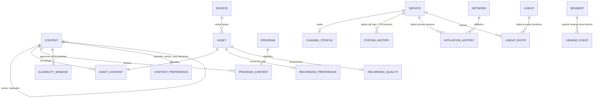

# TV MASTER catalog records

SQLite remains the local store. Catalog schema version 2 is additive: opening an
existing station creates the new tables and backfills stable content identities.
It does not reset the station, rewrite files, or change any published broadcast.



## Identity versus media

`content` represents a show, episode, movie, commercial, bumper, promo, station ID
or PSA. Episode title, season/episode numbers, original air date and episode
metadata can be null. A dated claim requires evidence; unknown is not inferred.
Series/episode hierarchy uses `parent_id`. This permits cataloging unowned content.

An `asset` remains a recording-specific span: source, in/out timestamps and
technical duration. Multiple assets/recipes can map to one content identity.
Duration belongs to the recording, since different cuts may differ. Do not put
one purportedly universal runtime on the episode identity.

Legacy IDs receive `asset:<id>` and `program:<id>` identities; import explicit
links to join known recordings/recipes to a shared identity. Existing freeform
metadata is retained unchanged, not silently promoted into verified history.

## Channel modes and historical lookup

- `custom`: existing user-selected service/date/daypart rules.
- `themed`: those rules plus matching any configured theme tag on the program
  content or its series.
- `historical`: preserves explicit station and primary network history. Affiliation
  can constrain network-specific eligibility; it does not make every program in
  the station's day network programming.

`station_history` stores market, call sign and broadcast position by date.
`affiliation_history` separately stores primary network by date. Overlapping
station/primary-affiliation inserts are rejected rather than arbitrarily resolved.
Provider cable positions remain in dated `lineup`/`lineup_entry` records.

Lookup is available via `channels --market ... --provider ... --date YYYY-MM-DD`.
It resolves imported records, preserving their evidence/provenance. Automatic
external historical research/data providers are not implemented. Rochester
station/channel examples must not be seeded as verified without source evidence.

## Eligible periods

Each identity can have multiple `eligibility_window` rows. Windows for one
identity are alternatives (OR), with exclusive end dates and optional month,
service, network and market constraints (AND within a window). Series-level
constraints also apply to episodes. A dated network restriction resolves the
station's affiliation on that date.

The new windows additionally restrict legacy asset/program validity and dayparts;
they do not silently widen those existing periods. To cover several years, set a
broad legacy validity interval and add explicit seasonal windows, e.g. months
11/12. A window is an approved scheduling rule, not proof of an actual broadcast.

## Decisions, quality and counts

- `content_preference.never_schedule`: excludes an episode, series or spot and its
  descendants from newly composed blocks.
- `recording_preference.excluded`: excludes just one recording. Quality warnings
  alone do not block content. Alternate copies need their own eligible recipes;
  automatic substitution within an ordered-act recipe is not implemented.
- `favorite`: records a preference without overriding eligibility or exclusions.
  It does not currently change rotation weights.
- `recording_quality`: optional 0–100 human quality score and assessment.
- `quality_alert`: source- or recording-specific problems, severity and resolution
  timestamp. An alert does not become a content ban.
- Broadcast/segment records supply scheduled and actually aired counts. An
  episode is counted once per broadcast, not once per act. Aired means its
  occurrence has started on the simulated clock; it does not imply completion.
- `viewing_event` records explicitly reported watched milliseconds. Idempotent
  event IDs prevent duplicate submissions. It rejects viewing future material or
  claiming more elapsed time than the segment has aired. Browser telemetry is
  not yet wired to this API; counts remain zero unless events are recorded.

Published slots remain fixed after exclusions; the current release applies them
to future composition only. It does not suppress already published playback.

## Commands

After importing `examples/library.json` with your own paths:

```sh
python -m retro_tv import-records examples/records.json
python -m retro_tv channels --market rochester --provider home --date 1995-07-18
python -m retro_tv exclude example-episode --note 'Do not schedule this episode again'
python -m retro_tv exclude act-1 --recording --note 'Damaged recording'
python -m retro_tv exclude act-1 --recording --allow
python -m retro_tv favorite example-episode
python -m retro_tv quality act-1 --score 35 --assessment 'Tracking damage'
python -m retro_tv alert tracking-1 --asset act-1 --code tracking --details 'Bottom-field damage'
python -m retro_tv stats example-episode
```

These are local administrative commands, not public write endpoints. Catalog
import is transactional. No analyzer, upscaler, FFmpeg, GPU or network access is
needed for metadata-only operations.
